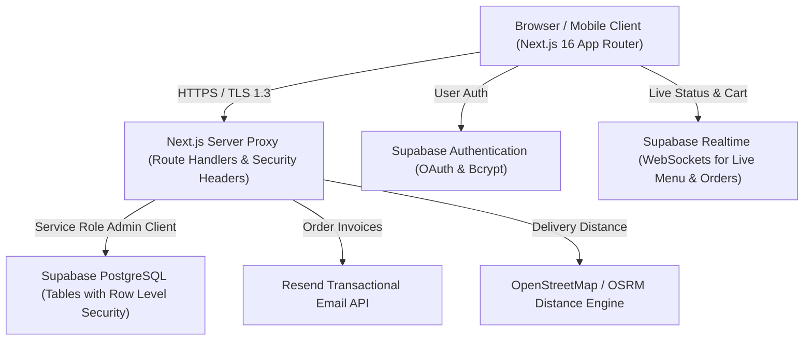
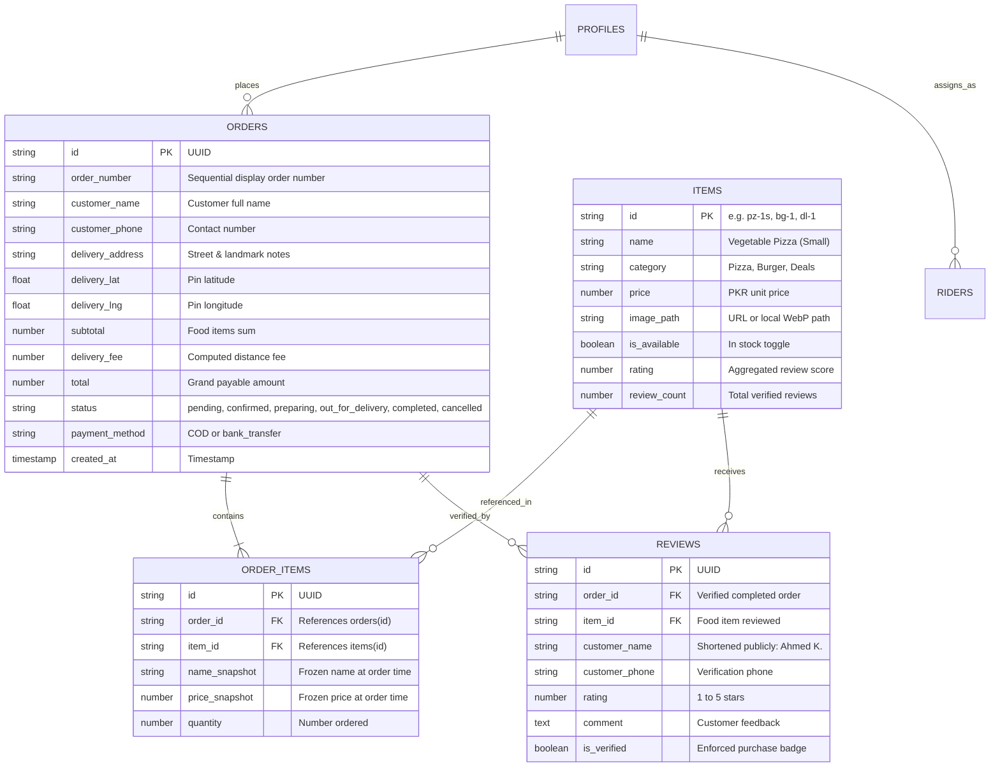

# Technical Architecture & System Design

**Project:** Azlan Fast Food & BBQ Point (Azlan Dairy)  
**Domain:** `https://azlanfastfood.com`  
**Stack:** Next.js 16 (App Router), React 19, TypeScript 5, Tailwind CSS 4, Supabase (PostgreSQL + RLS + Realtime), Leaflet, Zustand  

---

## 1. System Topology Overview



---

## 2. Directory Architecture & Layer Responsibilities

```
src/
├── app/                        # Next.js App Router (Thin Page Shells & API Routes)
│   ├── (public pages)/         # /, /cart, /orders, /orders/[id], /privacy-policy
│   ├── admin/                  # /admin (auth gate), /admin/dashboard
│   ├── rider/                  # /rider (shift portal), /rider/profile
│   └── api/                    # Route Handlers (/api/orders, /api/reviews, etc.)
├── assets/
│   └── fonts/                  # Self-hosted subset of Material Symbols Outlined (.woff2)
├── components/                 # Modular, feature-first UI components
│   ├── admin/                  # Order cards, metrics charts, price manager, thermal receipt
│   ├── auth/                   # Sign-in / Sign-up dialog modal
│   ├── cart/                   # Cart line items, distance checkout form, order summary
│   ├── home/                   # Hero, trust badges, category menu grid, testimonials, about
│   ├── layout/                 # Sticky navigation, footer, floating actions, store banner
│   ├── maps/                   # Leaflet interactive delivery pin picker
│   ├── menu/                   # Product card, size selector modal, optimized MenuImage
│   ├── orders/                 # Live order tracker, review prompt modal, receipt print
│   ├── rider/                  # Rider dashboard, active delivery focus, shift summary
│   └── ui/                     # Primitives (icon, hash-scroll-handler)
├── data/
│   ├── menu/                   # Modular menu datasets per category (burgers, pizzas, etc.)
│   └── menu-image-blur.generated.ts # Base64 blur previews generated by sharp
├── hooks/                      # useMounted, useStoreStatus, useGeolocation
├── lib/
│   ├── cart-store.ts           # Zustand cart store with localStorage synchronization
│   ├── menu-grouping.ts        # Groups sized variants (Small, Regular, Large) into single cards
│   ├── menu-image.ts           # Multi-resolution WebP variant resolver
│   ├── delivery.ts             # Haversine & road distance fee calculations
│   ├── settings.server.ts      # Server-side store status & schedule validation
│   └── supabase/               # Client, Server, and Service-Role Admin clients
├── scripts/                    # Build-time optimization & migration scripts
│   ├── build-icon-font.mjs     # Downloads subsetted Google Icon Font based on codebase usage
│   ├── optimize-images.mjs     # Generates 400w, 640w, 960w WebP + blur previews
│   └── sync-items.mjs          # Seeds / synchronizes Supabase items from local data
└── docs/                       # Comprehensive documentation suite
```

---

## 3. Data Model & Database Architecture

The application is backed by a PostgreSQL database managed via **Supabase** with **Row-Level Security (RLS)** strictly enabled.



---

## 4. State Management Architecture

1. **Zustand Cart Store (`src/lib/cart-store.ts`)**:
   - Manages active items, quantities, and price aggregations.
   - Automatically synchronizes with browser `localStorage` (`azlan-cart-storage`).
   - Supports atomic `add`, `remove`, `updateQuantity`, and `clear`.
2. **Store Status Provider (`src/hooks/use-store-status.tsx`)**:
   - Manages live open/closed restaurant state based on both automated operating hours (7:00 PM – 3:00 AM PST) and manual admin emergency toggles (`store_settings`).
   - Disables add-to-cart buttons when the store is closed, rendering "Store Closed" badges.
3. **Menu Item Consolidation (`src/lib/menu-grouping.ts`)**:
   - Identifies items with size designations (`(Small)`, `(Regular)`, `(Medium)`, `(Large)`).
   - Aggregates multi-variant items (e.g. 39 pizza variants) into 13 unique flavor cards with `"From Rs. [minPrice]"` and `"● 3 SIZES"`.
   - Passes exact variant IDs to the cart store upon size selection in the modal, preserving billing accuracy.

---

## 5. Performance & Asset Pipeline

### 5.1 Self-Hosted Icon Font Subsetting
- Full Material Symbols font is ~1 MB.
- `scripts/build-icon-font.mjs` scans all TSX/CSS files in `src/` for icon ligatures.
- Queries Google Fonts API for a **subsetted woff2** containing *only* the ~140 glyphs actually used in the project.
- Output: `src/assets/fonts/material-symbols-subset.woff2` (**85.6 KB**, 91% reduction).
- Loaded via `next/font/local` with `display: "block"` to prevent Flash of Unstyled Text (FOUT).

### 5.2 Multi-Resolution Image Variants
- Master high-res images are stored in `assets-source/` (outside git).
- `scripts/optimize-images.mjs` processes masters into 3 WebP variants in `public/images/menu/`:
  - `*-400.webp`: Product cards and mobile feeds.
  - `*-640.webp`: Tablet and medium containers.
  - `*-960.webp`: High-DPI screens and detail modal hero views.
- Precomputes 10px inline blur preview strings in `src/data/menu-image-blur.generated.ts` for instant placeholder blur-up.
- Next.js config applies `Cache-Control: public, max-age=31536000, immutable` for all static assets.

---

## 6. Security & Authorization Model

1. **Row Level Security (RLS)**:
   - Public users can only read items and their own active order via order ID.
   - Review insertions require a service-role verified completed order ID.
2. **Role Verification in Middleware / Route Handlers**:
   - `admin_auth`: Cryptographic cookie required for kitchen dashboard, price editing, and stats.
   - `rider_auth`: Required to access `/rider` shift feeds and delivery updates.
3. **Data Sanitization**:
   - Inputs are validated via `src/lib/sanitize.ts` to prevent XSS and SQL injection.
   - Customer phone numbers are normalized via `sanitizePhone()`.
   - Public reviews shorten customer surnames to preserve consumer privacy.
